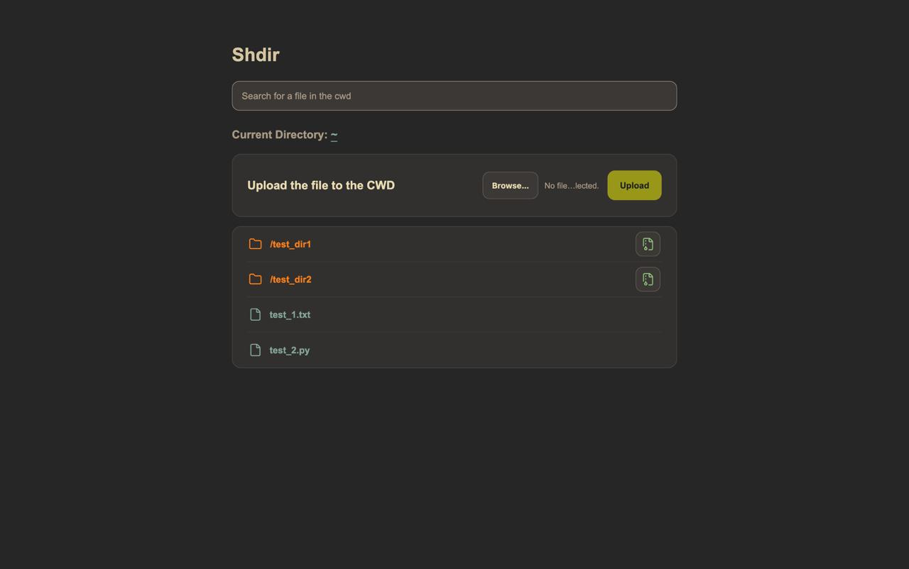
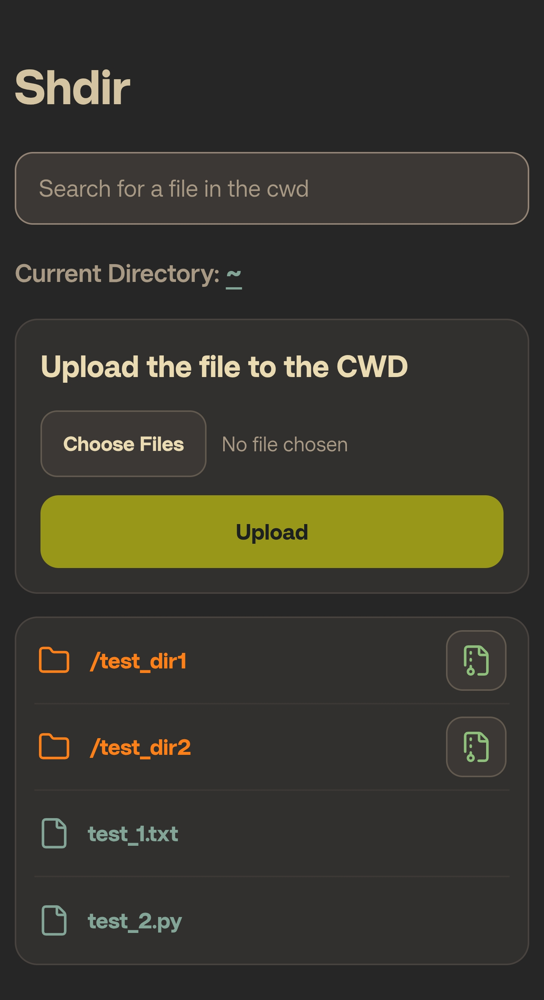
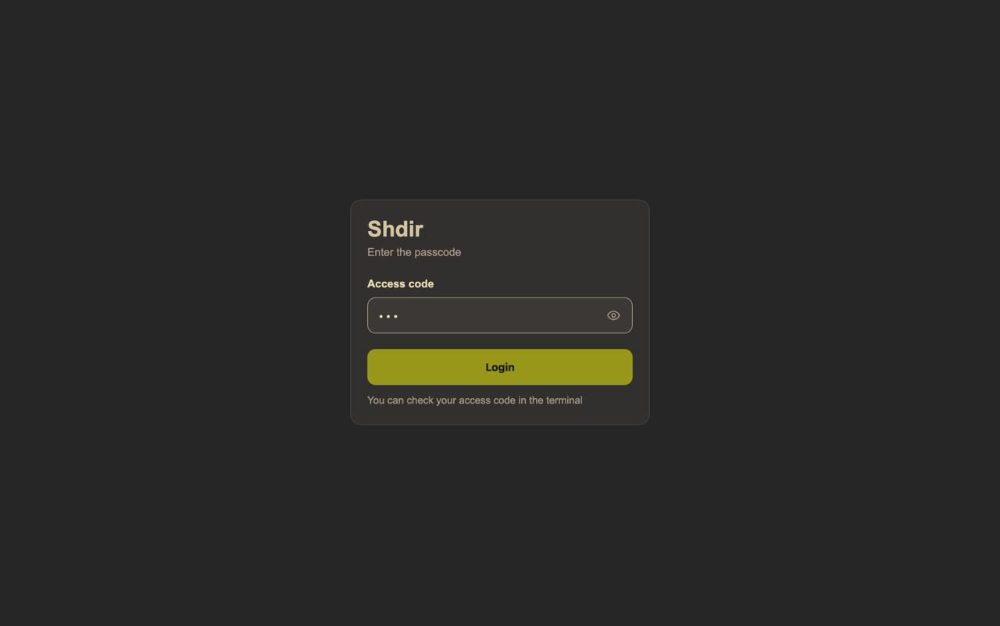

# shdir

### Simple. Fast. Local file sharing

shdir is a lightweight, self-hosted file-sharing utility that lets you transfer files between your computer and mobile devices over a local network.

No cloud storage, no accounts, no third-party file-sharing services. Just start the server, scan a QR code, and access your files directly from a browser.

---

## Features

- **QR Code Access** — automatically generates a QR code containing your local server address. Scan it with your phone to connect instantly.
- **Two-Way File Transfer** — download files from your computer and upload files from your phone.
- **Directory Browsing** — navigate through shared folders and their contents directly in your browser.
- **ZIP Downloads** — download entire directories as ZIP archives.
- **Optional Authentication** — protect access to your shared files with a randomly generated or custom access code.
- **HTTPS Support** — optionally enable encrypted connections using a temporary self-signed TLS certificate.
- **Upload Control** — disable file uploads when you only need to share files.
- **No Client Installation** — access everything through a standard web browser.
- **Lightweight Architecture** — powered by FastAPI and Uvicorn.

---

## Preview

<p align="center">
  
</p>

<p align="center">
  
  
</p>

---

## Requirements

- Python 3.15 or newer.
- A computer and a mobile device connected to the same local network.
- A modern web browser.

The server listens on port `8000` and binds to `0.0.0.0`, making it accessible to other devices on the local network.

---

## Installation

### Clone the repository

```bash
git clone https://github.com/akldrix/shdir
cd shdir
```


### Install dependencies with Poetry

```bash
poetry install
```

Make sure Poetry uses a compatible Python interpreter:

```bash
poetry env use python3.15
```

### Run shdir

```bash
poetry run shdir
```

You can also install the package locally using pip:

```bash
python -m pip install .
```

After installation, the `shdir` command becomes available.

---

## Quick Start

Start shdir in your current working directory:

```bash
shdir
```

You should see output similar to:

```text
Sharing Directory: /home/user/Downloads

Copy Link: http://192.168.1.100:8000/

[QR CODE]

Server is running. Press Ctrl + C to stop...
```

The exact output and address depend on your network configuration.

### Connect from your phone

1. Make sure your phone and computer are connected to the same Wi-Fi network.
2. Scan the QR code displayed in your terminal.
3. Open the generated address in your browser.
4. Browse, download, or upload files.

That's it. No mobile application or additional software is required.

---

## Command-Line Options

shdir provides several command-line arguments to customize the server.

| Option | Short | Description |
| --- | --- | --- |
| `--dir PATH` | `-d PATH` | Specify the directory to share. Defaults to the current working directory. |
| `--auth` | `-a` | Enable authentication with a randomly generated six-digit access code. |
| `--code CODE` | `-c CODE` | Set a custom access code. Automatically enables authentication. |
| `--https` | — | Enable HTTPS using a temporary self-signed TLS certificate. |
| `--no-upload` | `-u` | Disable file uploads to the computer. |
| `--help` | `-h` | Display available command-line arguments. |

### Examples

**Share a specific directory**

```bash
shdir --dir ~/Downloads
```

**Enable authentication**

```bash
shdir --auth
```

A random six-digit access code will be generated and displayed in the terminal.

**Set a custom access code**

```bash
shdir --code 123456
```

Using `--code` automatically enables authentication, so `--auth` is not required.

**Enable HTTPS**

```bash
shdir --https
```

**Disable file uploads**

```bash
shdir --no-upload
```

**Combine multiple options**

```bash
shdir --dir ~/Downloads --auth --https
```

This starts an HTTPS server with authentication and shares only the specified directory.

---

## How It Works

shdir runs a local FastAPI application powered by Uvicorn.

The application binds to all network interfaces (`0.0.0.0`) on port `8000`, allowing other devices on the same network to connect.

### 1. Local IP Detection

shdir determines the computer's local IP address by creating a UDP socket and selecting the network interface associated with an external route.

The socket is closed immediately afterward.

The detected address is used to construct the server URL.

### 2. QR Code Generation

A QR code containing the server URL is generated and rendered directly in the terminal.

This eliminates the need to manually type an IP address on your phone.

### 3. Directory Browsing

The web interface allows you to navigate through the shared directory and its subdirectories.

Files are served as downloadable attachments using FastAPI's `FileResponse`.

### 4. File Uploads

When uploads are enabled, files can be sent from a mobile device to the currently opened directory.

Uploads use `POST` requests with multipart form data.

Multiple files can be selected in a single upload operation.

**Note:** Uploading a file with an existing filename overwrites the existing file.

### 5. ZIP Downloads

Directories can be downloaded as ZIP archives.

shdir recursively collects files from the selected directory and creates an archive in memory before returning it to the browser.

### 6. Authentication

When authentication is enabled, shdir generates a six-digit access code or uses a user-provided code.

The access code is entered through the web login page.

After successful authentication, the server creates an HTTP-only session cookie used to authorize subsequent requests.

---

## HTTPS and Browser Security Warnings

shdir supports HTTPS through the `--https` option.

However, you may encounter a browser security warning when opening the generated HTTPS address.

**This is expected behavior. It does not necessarily mean that the connection is unencrypted.**

### Why does the browser show a warning?

shdir generates a temporary self-signed TLS certificate using Python's `cryptography` library.

The certificate:

- Uses RSA with a 2048-bit key.
- Is signed by itself rather than a publicly trusted Certificate Authority (CA).
- Contains the detected local IP address and `localhost` in its Subject Alternative Names (SAN).
- Is valid for seven days.
- Is generated again when the server starts.

Browsers maintain their own trusted certificate authorities.

Because shdir's certificate is self-signed, the browser cannot establish a trusted certificate chain and therefore cannot independently verify the server's identity.

You may see errors such as:

- `NET::ERR_CERT_AUTHORITY_INVALID`
- `SEC_ERROR_UNKNOWN_ISSUER`
- `Your connection is not private`

### Is the connection encrypted?

Yes.

HTTPS provides an encrypted TLS connection even when using a self-signed certificate. Even so, encryption and server identity verification are separate security properties. Since the certificate is not issued by a trusted Certificate Authority, the browser cannot automatically verify that it belongs to the intended server.

However, encryption and identity verification are different things.

A self-signed certificate does not provide the same protection against man-in-the-middle attacks as a certificate issued by a trusted CA.

### How should I handle the warning?

For local testing, only proceed when you have verified that you are connecting to your own shdir instance on a network you trust.

For regular use without browser warnings, a persistent certificate trusted by both devices is preferable.

Because shdir currently generates a new temporary certificate on each startup, manually trusting one generated certificate will not provide a permanent solution.

**Important:** HTTPS does not replace authentication. Use `--auth` or `--code` when you want to restrict access.

---

## Security and Privacy

shdir is designed for convenient file sharing within a trusted local network.

A few important security considerations:

### Local Network Access

The server listens on `0.0.0.0`, meaning it is reachable through the computer's available network interfaces.

Without authentication, anyone who can access the server address may browse and download shared files.

### Authentication

Enable access protection with:

```bash
shdir --auth
```

Or specify your own code:

```bash
shdir --code YOUR_ACCESS_CODE
```

Keep the access code private. It is displayed in the server terminal.

### File Uploads

Uploads are enabled by default.

You can disable them with:

```bash
shdir --no-upload
```

Uploaded files with matching names overwrite existing files.

### Shared Directory

Everything inside the selected directory is potentially accessible through the web interface, including its subdirectories.

Avoid sharing directories containing passwords, private keys, configuration secrets, or other sensitive data.

### Network Exposure

Do not expose shdir directly to the public internet or run it on an untrusted network.

For additional protection:

- Use authentication.
- Enable HTTPS when appropriate.
- Keep the shared directory limited to the files you actually need.
- Use a trusted private network.
- Stop the server when file sharing is no longer required.

shdir is a lightweight local utility, not a hardened public file-hosting platform.

---

## Limitations

- The default server port is `8000`.
- The server does not provide remote user management.
- Authentication uses one shared access code rather than individual accounts.
- HTTPS uses a temporary self-signed certificate.
- ZIP archives are assembled in memory, so large directories can consume significant RAM.
- There is no built-in file deletion, renaming, or editing interface.
- Existing files can be overwritten during uploads.

---

## Technology Stack

shdir is built with the following technologies:

| Technology | Purpose |
| --- | --- |
| Python | Core application logic |
| FastAPI | HTTP API and routing |
| Uvicorn | ASGI server |
| Jinja2 | HTML template rendering |
| qrcode | Terminal QR code generation |
| cryptography | Temporary TLS certificate generation |
| python-multipart | Multipart file uploads |

---

## Project Structure

```text
shdir/
├── src/
│   └── shdir/
│       ├── app.py
│       ├── cli.py
│       ├── templates/
│       │   ├── index.html
│       │   └── login-page.html
│       ├── static/
│       │   ├── styles.css
│       │   ├── login-style.css
│       │   └── script.js
│       ├── icons/
│       └── utils/
│           ├── colors.py
│           ├── logs.py
│           ├── net.py
│           └── security.py
├── pyproject.toml
└── README.md
```

---

## Development

Contributions are welcome!

To set up a development environment:

```bash
git clone https://github.com/akldrix/shdir
cd shdir

poetry install
poetry env use python3.15
```

Run the application from the development environment:

```bash
poetry run shdir
```

### Contributing Guidelines

When contributing, please:

1. Check existing issues before opening a new one.
2. Describe the problem or proposed improvement clearly.
3. Keep changes focused and consistent with the existing codebase.
4. Test your changes before submitting a pull request.
5. Include relevant screenshots for UI changes.

For larger changes, consider opening an issue first to discuss the proposed implementation.

### Reporting Bugs

When reporting a bug, please include:

- Your operating system.
- Python version.
- shdir version.
- Command used to start the server.
- Relevant terminal logs.
- Steps required to reproduce the issue.

Please never include private access codes, passwords, or sensitive file contents in bug reports.

---

## License

shdir is licensed under the **GNU General Public License v3.0 (GPL-3.0)**.

See the `LICENSE` file for the full license text.

---

<p align="center">
  Made for simple and private file sharing.
</p>
